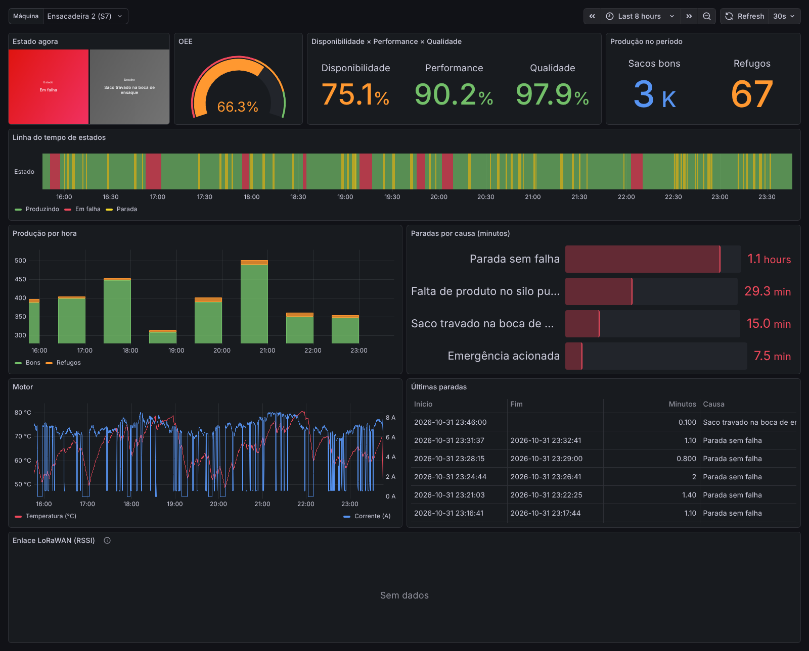

# machine-telemetry

**Industrial machine telemetry, from the PLC to OEE.** Reads the PLC a machine already has, over OPC UA or S7, and
shows in real time what it is doing, how long it stopped and why, how much it produced and its OEE. Works over an
unreliable internet link and, where there is no network, over LoRaWAN.

[Versão em português](README.md)



## Background

This continues my Computer Engineering capstone (Unoesc, 2024), published at Inatel's Incitel 2025 as *"Cloud
Monitoring System for Programmable Logic Controllers for IoT"*: a Siemens S7-1200 read by a Raspberry Pi 4 (OPC UA)
and a repurposed TV box (S7 PUT/GET), Node-RED at the edge, LoRaWAN uplinks and TagoIO dashboards. Here that
architecture becomes something that can be installed at a plant: a tested Java gateway instead of Node-RED flows, an
SQLite outbox instead of the MariaDB integration queue, a binary LoRaWAN payload, and an own platform instead of
TagoIO, computing states, stops and OEE.

## Components

| Folder | |
|---|---|
| [plc-sim](plc-sim) | simulated S7-1200 (Python) running a bagging machine, serving one data block over OPC UA and S7 |
| [gateway](gateway) | edge gateway (Java 25, no framework): OPC UA (Eclipse Milo) or an S7 client written from the protocol, state detection, windowed aggregates, SQLite outbox, MQTT or a LoRaWAN modem driven by AT commands |
| [platform](platform) | Spring Boot 4.1 and PostgreSQL 18: MQTT and The Things Network ingestion, state history, stops, OEE, REST API |
| [lorawan](lorawan) | payload format, TTN formatter, test vectors shared by the encoder, the formatter and the decoder |
| [grafana](grafana) | provisioned dashboard |
| [docs](docs) | [MQTT contract](docs/mqtt.md), [commissioning guide](docs/comissionamento.md) (Portuguese) |

## Run the demo

```bash
cp .env.example .env    # fill in the passwords
docker compose up -d --build
```

Grafana at <http://localhost:3000>, API at <http://localhost:8080/api/v1/machines> with `X-API-Key`.
`tools/backfill.py` generates hours of history; `tools/e2e.sh` brings everything up and checks that the OPC UA, S7
and LoRaWAN paths delivered.

## Design decisions

- **States as events, everything else aggregated**: read every 250 ms, send on change plus a 10 s summary.
- **Cyclic reads instead of an OPC UA subscription**, so OPC UA and S7 share one contract and every cycle is a
  complete picture of the machine.
- **Own S7 client**: only data block reads are needed; no native library on ARM, and error messages phrased for
  commissioning.
- **Bounded SQLite outbox**: deleted only after the broker's PUBACK; when full, old telemetry goes before any state
  change.
- **At least once on the wire, once in the database**: the outbox sequence travels with each message and the
  platform ignores repeats; for TTN the key is session + frame counter.
- **Counters as totals**, differences taken modulo 2^32 (2^16 over LoRaWAN), so lost uplinks and wrapping counters
  lose no units, and an operator reset is recognized.
- **Time-in-state in the LoRaWAN payload**, so a stop is placed correctly with uplinks five minutes apart.
- **NO_DATA is a state**: an unreachable PLC or a silence longer than expected counts as neither running nor stopped.
- **OEE in SQL**, shared by the API and Grafana.

## Tests

74 automated tests (simulator 10, gateway 37, platform 20, TTN formatter 6, end to end 1), all run by GitHub Actions.

## Limitations

OPC UA security `None` only (with user and password); no shift calendar; single tenant; no TLS in the demo; no
vibration analysis yet.

## License

[PolyForm Noncommercial 1.0.0](LICENSE.md). For commercial use, contact me at
[carlosvieira.eng.br](https://carlosvieira.eng.br/).
