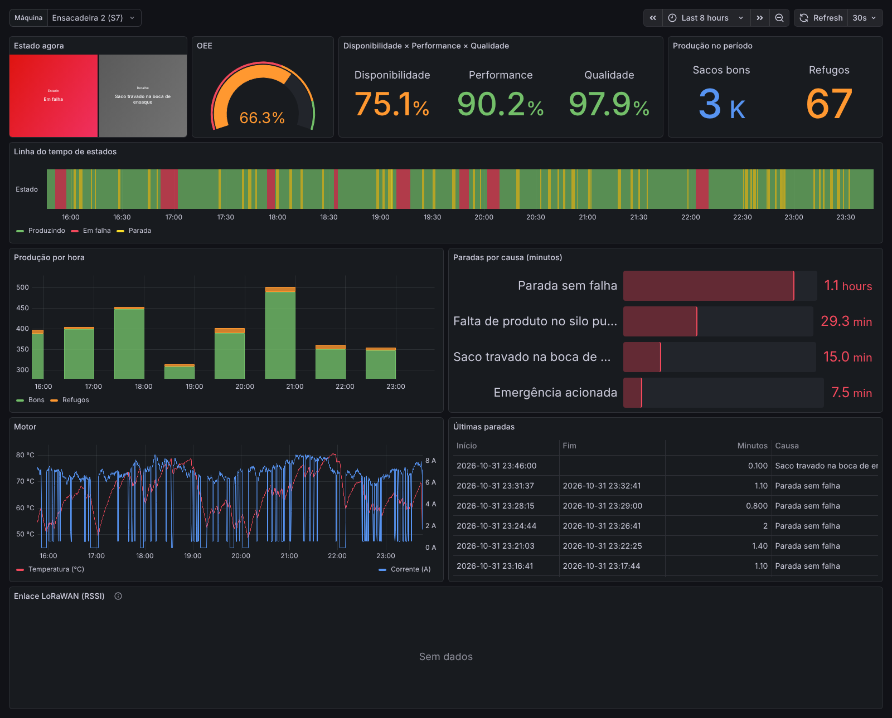
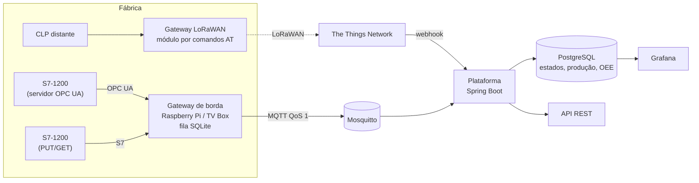

# machine-telemetry

**Telemetria de máquinas industriais, do CLP ao OEE.** Lê o CLP que a máquina já tem, por OPC UA ou S7, e mostra
em tempo real o que ela está fazendo, quanto tempo parou e por quê, quanto produziu e qual o OEE. Funciona com
internet instável e, onde não há rede, por LoRaWAN.

[English version](README.en.md)



*Painel com 8 horas de uma ensacadeira simulada. O OEE de 65 % sai de 73 % de disponibilidade, 90 % de performance
e 98 % de qualidade; as paradas por causa mostram onde está a perda.*

## Origem

Este projeto continua o meu TCC em Engenharia de Computação (Unoesc, 2024), publicado no Incitel 2025 do Inatel como
*"Sistema de Monitoramento em Nuvem de Controlador Lógico Programável para IoT"*. O TCC validou uma arquitetura de
baixo custo: um S7-1200 lido por uma Raspberry Pi 4 (OPC UA) e por uma TV Box reaproveitada (S7 PUT/GET), Node-RED
na borda, envio por LoRaWAN e painéis no TagoIO. Os trabalhos futuros apontavam uma plataforma própria e indicadores
de manutenção.

Aqui a arquitetura vira um sistema que pode ser instalado em uma fábrica:

| No TCC | Neste projeto |
|---|---|
| Node-RED com fluxos | gateway em Java, um jar só, testado, roda no Raspberry Pi e na TV Box |
| `node-red-contrib-opcua` e `node-red-contrib-s7` | cliente OPC UA (Eclipse Milo) e cliente S7 escrito a partir do protocolo |
| tabela `INTEGRATION_QUEUE` no MariaDB | fila local em SQLite, entrega em ordem, sobrevive a queda de energia |
| média de 10 leituras a cada 6 s | estados como eventos na hora em que mudam, e média/mín/máx por janela |
| `AT+SEND` com o valor em texto | payload binário de 9 a 13 bytes, comando AT configurável, respeitando o intervalo de 6 s |
| TTN → webhook → TagoIO | TTN → webhook → plataforma própria, com token e aplicação conferidos |
| um valor de 0 a 10 no painel | estados, paradas com causa, produção, OEE, sinais do motor, RSSI do enlace |

## Para quem

Indústrias e agroindústrias de pequeno e médio porte que têm máquinas com CLP e não sabem, com número, quanto tempo
elas ficam paradas. Fábricas de ração, frigoríficos, cerealistas, metalúrgicas: o sinal de "máquina rodando", o de
"falha" e um contador de peças já existem no CLP. O que falta é juntar, guardar e mostrar.

- **Sem trocar o CLP nem mexer na lógica da máquina.** O programa só copia para um bloco de dados sinais que já
  existem ([guia de comissionamento](docs/comissionamento.md)).
- **Hardware barato na borda.** Um Raspberry Pi ou uma TV Box com Linux, como no TCC.
- **Não perde dado quando a internet cai.** O gateway guarda tudo em disco e envia depois, na ordem.
- **Máquina longe da rede.** Silo, moega, casa de bombas: LoRaWAN pela The Things Network.
- **Números que a gerência usa.** OEE com os três fatores, ranking de paradas por causa, produção por hora.

## Arquitetura



| Pasta | O que é |
|---|---|
| [plc-sim](plc-sim) | S7-1200 simulado (Python): uma ensacadeira com paradas, falhas, perda de velocidade e refugo, servindo o mesmo DB por OPC UA e por S7 |
| [gateway](gateway) | gateway de borda (Java 25, sem framework): lê o CLP, detecta estados, agrega, fila local, MQTT ou LoRaWAN |
| [platform](platform) | plataforma (Spring Boot 4.1, PostgreSQL 18): ingestão MQTT e TTN, histórico de estados, paradas, OEE, API |
| [lorawan](lorawan) | formato do payload, formatador para a TTN e vetores de teste compartilhados |
| [grafana](grafana) | painel provisionado |
| [docs](docs) | [contrato MQTT](docs/mqtt.md) e [comissionamento](docs/comissionamento.md) |

## Rodando a demonstração

Precisa de Docker. Sobe dois CLPs simulados (um lido por OPC UA, outro por S7), o gateway, um dispositivo LoRaWAN
simulado, o broker, a plataforma e o Grafana.

```bash
cp .env.example .env          # preencha as senhas
docker compose up -d --build
```

- Grafana: <http://localhost:3000> (usuário `admin`, senha do `.env`)
- API: <http://localhost:8080/api/v1/machines> com o cabeçalho `X-API-Key`

Para o painel não começar vazio, dá para gerar horas de histórico antes de ligar o gateway:

```bash
docker compose up -d postgres mosquitto platform
pip install paho-mqtt==2.1.0
python tools/backfill.py --hours 8 --password "<MQTT_ADMIN_PASSWORD>"
docker compose up -d --build
```

`tools/e2e.sh` sobe tudo e confere pela API que os três caminhos (OPC UA, S7, LoRaWAN) entregaram dados.

## Decisões técnicas

- **Estados como eventos, o resto agregado.** O gateway lê o CLP a cada 250 ms, mas só envia quando o estado muda,
  mais um resumo a cada 10 s. Mandar toda leitura gastaria banda à toa; mandar só médias esconderia quando a máquina
  parou.
- **Leitura cíclica em vez de assinatura OPC UA.** Assim OPC UA e S7 ficam atrás do mesmo contrato e cada ciclo traz
  uma foto completa da máquina, que é o que a detecção de estado precisa.
- **Cliente S7 próprio.** São três camadas (TPKT, COTP, S7) e só a leitura de DB é necessária; escrever direto evita
  biblioteca nativa no ARM e deixa as mensagens de erro em termos de comissionamento ("DB otimizado?",
  "PUT/GET liberado?").
- **Fila em SQLite com limite.** Cada evento vai para o disco antes de sair e só é apagado depois do PUBACK do broker.
  Com a fila cheia, descarta primeiro telemetria antiga, nunca uma mudança de estado.
- **Entrega pelo menos uma vez, gravação uma vez só.** O número de sequência da fila acompanha a mensagem; a
  plataforma guarda `(gateway, seq)` e ignora repetições. Na TTN, a chave é sessão + contador de quadros.
- **Contadores como totais.** O gateway manda o valor do contador do CLP, não a diferença. A plataforma calcula a
  diferença módulo 2^32 (ou 2^16 no LoRaWAN), então um uplink perdido ou um contador que estourou não perdem peças, e
  um contador zerado pelo operador é reconhecido.
- **Payload LoRaWAN com tempo no estado.** Com uplinks a cada 5 minutos, o payload diz há quantos segundos a máquina
  está no estado atual, e a plataforma posiciona a parada no tempo certo.
- **"Sem dados" é um estado.** CLP inacessível ou silêncio maior que o esperado vira `NO_DATA`, que não conta como
  máquina rodando nem parada.
- **OEE em SQL.** Disponibilidade, performance, qualidade e paradas são funções no PostgreSQL usadas pela API e pelo
  Grafana, então os dois não divergem.

## Testes

| Parte | Testes | O que cobrem |
|---|---|---|
| plc-sim | 10 | layout do DB, escala analógica, perdas do modelo, determinismo |
| gateway | 37 | quadros S7, CPU falsa que força leitura dividida, estados e agregação, fila (ordem, reinício, limite), MQTT com broker que cai e volta, diálogo AT (OK, busy, erro, dois RxConfig), payload |
| platform | 20 | uma hora roteirizada com OEE conferido à mão, duplicatas, site errado, lacunas, atraso, estado perdido, webhook da TTN, ingestão MQTT |
| lorawan | 6 | formatador da TTN contra os mesmos vetores do gateway e da plataforma |
| ponta a ponta | 1 | compose inteiro: OPC UA, S7 e LoRaWAN até a API |

O CI do GitHub Actions roda todos.

## Limitações e próximos passos

- OPC UA só com segurança `None` (com usuário e senha). O TCC usou Basic256Sha256 com Sign&Encrypt; é o próximo item.
- Sem calendário de turnos: todo tempo com dados conta como tempo planejado.
- Um cliente por instalação. Para vender como serviço: multi-tenant, alertas (Telegram, e-mail) e relatório mensal.
- MQTT sem TLS na demonstração; em produção, Mosquitto com TLS na porta 8883 (o gateway aceita `ssl://`).
- Sensores de vibração e análise por FFT para manutenção preditiva, como sugerido no TCC.

## Licença

[PolyForm Noncommercial 1.0.0](LICENSE.md): livre para estudar e usar sem fins comerciais. Para uso comercial, fale
comigo em [carlosvieira.eng.br](https://carlosvieira.eng.br/).
